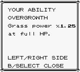
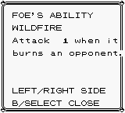
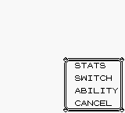
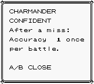
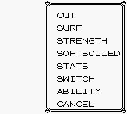

# Starter ability prototype

This cumulative test patch adds one active ability to the standard Bulbasaur/Ivysaur/Venusaur and Charmander/Charmeleon/Charizard lines. Unique variants and other species have no ability yet. Their existing sprites, stats, moves, encounters and trainer changes remain included.

## Trying it

Choose Bulbasaur: the rival already chooses Charmander. Each Pokémon receives one of its five slots with equal 20% odds. The normal starting moves and levels are preserved: Bulbasaur first learns Vine Whip at level 10, Charmander Ember at level 7. The opening level-5 fight therefore tests the panel and only those effects that its moves/HP can trigger. Automated higher-level battles cover the attacking effects.

At the battle command menu, press **Select** to inspect abilities. **Left/Right** changes between player and opponent; **B or Select** closes the panel. Inspecting does not spend a turn, PP or an item. Both abilities are immediately visible. This replaces Select's old opponent-cry shortcut. Map a keyboard key to the emulator's Game Boy Select button; the ROM cannot directly read keyboard 1/2/Esc. Outside battle, open **POKéMON**, choose a party member, then choose **ABILITY**. The panel shows that selected Pokémon’s nickname, ability and description. **A, B or Select** closes it. The action menu now lists STATS, SWITCH, ABILITY and CANCEL, below any field moves. Nature and held-item systems are not added by this patch.

## Party menu inspection

The box expands upward for field moves and widens to fit ABILITY. The party viewer reads the selected Pokémon’s stored slot rather than the last active battler’s ability. Closing restores the party screen and preserves the overworld backup. Unsupported species show NO ABILITY. An unassigned existing starter receives its persistent slot when inspected or next sent out.

## Slot definitions

| Slot | Bulbasaur line | Effect |
|---|---|---|
| 1 | Poison Leaf | Damaging Grass hits have a 25% chance to inflict ordinary poison. |
| 2 | Chlorophyll | Effective battle Speed is multiplied by 1.5 while current HP is strictly below one third maximum HP. |
| 3 | Overgrowth | Normal Grass damage is multiplied by 1.25 at exactly full HP. |
| 4 | Photosynthesis | Recover floor(maximum HP / 16), minimum 1, once per completed round while strictly above half HP; capped at maximum HP. |
| 5 | Thick Vines | Normal physical damage is multiplied by 1.2. Physical/special follows the existing Gen 1 type categories. |

| Slot | Charmander line | Effect |
|---|---|---|
| 1 | Blaze | Normal Fire damage is multiplied by 1.25 while strictly below one third HP. |
| 2 | Combustion | Damaging non-Fire hits have a 15% burn chance (38/256, approximately 14.84%). |
| 3 | Wildfire | Attack rises one stage when its action newly burns the opponent, including burns from normal move effects. No boost against an already burned target. |
| 4 | Hot Temper | Special rises one stage after surviving a physical damaging hit; once per Pokémon per battle. |
| 5 | Confident | Accuracy rises one stage after an accuracy miss with a damaging attack; once per Pokémon per battle. Type immunity does not count. |

Poison Leaf and Combustion roll per damaging hit, including individual multi-hit strikes. They do not apply through Substitute, against a fainted target, or over an existing major status. Poison types block poison, Fire types block burn, and Curse blocks poison under the existing rules. Status moves such as Sleep Powder do not gain an extra poison roll. HP gates are checked using full 16-bit values; damage multipliers round down. Fixed-damage attacks do not receive the normal damage boosts.

Chlorophyll updates without accumulating stat stages, affects turn order, escape Speed and Electro Ball, and switches off after healing out of its HP range. Photosynthesis runs before this game's custom end-round Wrap/Fire Spin ticks and never revives a fainted Pokémon. Hot Temper/Confident remain used after switching or Haze; new battles reset their flags. Existing stage caps still apply. Transform and Duplicate retain the user's ability; copied species/types/moves do not overwrite the cached ability identity.

## Storage and current limits

The stored slot survives evolution, saving and normal party/box/daycare copies. This prototype's two evolution lines use the same five abilities throughout. The slot-based storage also supports replacing a slot's ability in a later evolution when more species tables are added.

The otherwise unused Gen 1 stored catch-rate byte encodes a slot with tags F9–FD. No party/box/save structure grows; capture odds still read the separate species-header catch rate. Untagged existing starter Pokémon receive a slot on next send-out. The byte must not simultaneously be repurposed as a Gen 2 held item; cross-version/Gen 2 trading is outside this prototype. Enemy trainer parties roll when generated, so the rival is not guaranteed the same slot in a later encounter. Abilities are disabled in link battles pending a synchronized multiplayer design. Opponent AI retains its existing move-scoring rules; ability-specific tactical scoring is a later pass.

Transient flags occupy 26 bytes from the former unused bottom of the stack; the stack top and saved data addresses are unchanged. The remaining stack allocation is 221 bytes. Automated battle tests pass, but longer playtesting is still needed before expanding to the full roster.

## Validation

Both Red and Blue build. Tests cover all five equal random buckets and rejection sampling; all six species/slot mappings; migration of old starters; gift generation; real rival party creation and send-out; saved slots; both sides' ten effects; full-HP and one-third/half-HP boundaries; status chances and immunities; Substitute and fainting protection; used-once flags; healing caps; conditional Speed; actual attack execution; panel paging/closing and tile restoration; selected-party inspection with A/B/Select closing; preservation of battle IDs and the overworld backup; action rendering and actual dispatch for zero through four field moves. The panel previews render the actual panel tilemaps using the game's font and border assets.

All 37 pre-existing regression suites passed, including prior moves, species, sprites, encounters, trainer/rematch sets, saves and the new type chart. BPS application must reproduce both built ROMs byte for byte.
