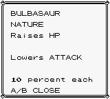
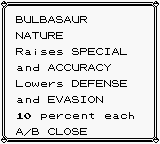

# 196-nature system

This cumulative Red/Blue patch implements permanent, nameless natures for the full 183-species roster, including custom Pokémon. All earlier sprites, species, moves, typings, encounters, trainers, rematches, badge changes and starter abilities remain included.

## Using it

Open **POKéMON → choose a Pokémon → NATURE**. Its actual nature is described using “Raises” and “Lowers,” with no nature name. The screen also states “10 percent each.” A, B or Select closes the panel. Field moves, Stats, Switch, Ability, Nature and Cancel remain available. A Pokémon with four field moves uses compact spacing so all nine actions fit on the Game Boy screen.

Every Pokémon gets a uniformly random nature, independent of its species, DVs and nickname. There are no neutral natures. Existing individuals retain their nature; evolution, level changes and reloading do not select another one. Trainer Pokémon roll when their parties are generated and retain their nature through switches during that battle. Boss-specific nature overrides are not configured in this release; the stored ID can support them later.

## Definitions

The eight attributes, in bit order, are HP, Attack, Defense, Speed, Special, Accuracy, Crit and Evasion.

- IDs 0–55: all 56 ordered choices of one +10% and one different −10% attribute.
- IDs 56–195: 140 distinct choices of two +10% and two different −10% attributes.
- The complex selection uses 17 complete eight-element cyclic rotation orbits and one four-element orbit. Each attribute appears positively 35 times and negatively 35 times in that selection; including simple natures, each appears positively and negatively 42 times.
- Orbit representatives are canonical sorted mask pairs. Ordering uses SHA-256 of `Purple-Iron nature orbits v1:` followed by the representative’s two mask bytes. This makes the selection reproducible. `tools/generate_natures.py` validates uniqueness, disjoint positive/negative masks and equal representation, then writes the compact 392-byte lookup table.

The engine looks up two masks rather than running 196 separate effects or storing 196 descriptions.

## Calculations

### HP and the four normal stats

Calculate the original stat from the existing species, level, DVs and Stat Experience logic, then multiply by 110/100, 90/100 or 100/100. Round down, retain the engine’s 999 cap and enforce a minimum underlying stat of 1. Recalculation starts from the normal formula, so the modifier never accumulates.

Nature-adjusted values are the actual stored/displayed underlying stats. Stage changes, Shin badge boosts, burn, paralysis, Reflect and Light Screen operate on them through existing routines. Ordinary critical damage uses nature-adjusted underlying stats while retaining the intended stage/screen handling. Nature Speed is not added a second time to base-Speed critical-hit probability. Fixed-damage moves keep their existing damage behavior.

Old party saves are recalculated once when loaded. Conversion preserves missing HP, keeps living Pokémon at least at 1 HP, caps at the new maximum and leaves fainted Pokémon at 0. Old boxed records recover their old maximum from their deposited level/DVs/EVs before the same conversion; their maximum is recalculated normally on withdrawal. Level-up and evolution HP-delta paths also preserve fainting. Native healing remains intentional healing; native vitamin behavior remains otherwise unchanged.

Transform retains the user’s permanent nature identity and its Accuracy/Crit/Evasion traits. Copied Attack/Defense/Speed/Special values already contain the target’s nature adjustment and are not multiplied again. Critical hits while transformed use those copied underlying stats. HP and ability remain the user’s own, as before. Duplicate still copies only a move.

### Accuracy and Evasion

After the existing accuracy/evasion stages, apply one combined ratio:

`hit probability × attacker Accuracy factor ÷ defender Evasion factor`

Factors are 90, 100 or 110. Equal factors cancel exactly without intermediate rounding. The final result is capped at the existing guaranteed-hit threshold.

Shin compares RNG inclusively, so the implementation scales the number of successful RNG outcomes (`threshold + 1`) and then converts back to a threshold. Results are rounded down to the available 8-bit probability quantum. This is multiplicative probability, not a ten-percentage-point change. Guaranteed-hit moves, X Accuracy, conditional always-hit moves, protection checks and the existing fix for the unwanted 1/256 miss retain their normal exceptions.

### Critical-hit rate

Retain the existing base-Speed calculation, high-crit ×2, Focus Energy/Dire Hit stacking and cap. Multiply the final ordinary critical threshold by 110/100, 90/100 or 100/100, round down, and cap at the existing 255/256 threshold. Guaranteed conditional critical hits remain guaranteed. Speed and Crit nature attributes are independent.

## Storage and saves

Party records remain **44 bytes**, boxed/daycare records **33 bytes**, and active battle records **29 bytes**. Saved offsets and checksum block sizes do not move.

| Stored byte | New meaning |
|---|---|
| Offset 5, low five bits | Actual first type ID |
| Offset 5, high three bits | Persistent ability slot, 1–5 |
| Offset 6, low five bits | Actual second type ID |
| Offset 6, high three bits | Format marker `111` |
| Offset 7, formerly stored catch rate | Nature ID, 0–195 |

Battle types are restored from the actual species header. Capture odds and the existing catch-rate-based NPC score use the species-header catch rate, not this metadata byte. The low-bit type format supports IDs 0–31; adding types beyond that range would require another storage revision.

**Older saves migrate forward; no new game is required for valid existing saves.** A native old type cannot contain the new marker, so an old catch rate is never silently treated as a nature. Previous F9–FD ability tags preserve their slot when converted. Party records migrate on valid save load; boxed/daycare records migrate on access, before copying or recalculation. Save normally after loading/accessing an old save to persist the conversion. Keep nature-format saves on nature-enabled builds; they are not backward compatible with older ROMs.

## Link compatibility

**External Cable Club battles/trades are unavailable in this release.** The receptionist and room interaction explain the restriction, and passive legacy connection establishment is disabled. Unmodified Red/Blue, old Shin builds and Gen 2 cannot safely interpret the new fields. A matching-build link protocol is not claimed or implemented. NPC in-game trades remain supported and generate a fresh nature for the received Pokémon.

## Validation and limits

Both Red and Blue build as the same 1 MiB cartridge format. No custom sprite assets were edited. Nature/ability scratch occupy former bottom-of-stack space, leaving 189 stack bytes and the same DFFF stack top; emulator checks guard the lower 32 stack bytes during the new test paths.

The nature harness verifies:

- The actual ROM’s 196 definitions, balance and reproducible generated source.
- All 980 nature/ability-slot combinations; rejection sampling; legacy marker conversion without rerolling existing ability slots.
- All 196 natures against the five underlying stats, repeated recalculation, floor rounding, low values and the 999 cap.
- Accuracy/Evasion factor combinations on both sides, inclusive probability thresholds, all nature Crit ratios, guaranteed-hit/critical exceptions and the no-1/256-miss behavior.
- Starter/gift/trainer creation, stable trainer switches, wild capture identity and capture reloads.
- Native PC/daycare transfers, daycare experience, party swapping, NPC OT/name copying, evolution type refresh, healing, save/reload and forward HP migration, including fainted Pokémon.
- Transform on both sides, retained nature/ability identity and copied nature-adjusted critical-hit stats.
- Every nature description, selected-party identity, A/B/Select closing, screen restoration and preservation of the overworld backup.
- Menu rendering and action dispatch with zero through four field moves; blocked legacy link entry points.

All 37 earlier regression suites also pass, including sprites, species, move effects, trainer/rematch parties, encounters, critical hits, saves and the type chart. The historical legacy-damage source integrity check now follows an explicit compatibility ledger recording the necessary transformed-critical-stat change. BPS patches are round-trip checked against the built ROMs.

These are automated engine and UI-layout checks, not a complete manual playthrough. Rare battle combinations still merit playtesting. Abilities remain limited to the two starter families from the prototype, and ability/nature-specific tactical AI tuning is not part of this patch.

## Reviewable commits

1. `0a72b91` — definitions and repository audit.
2. `fbdbea0` — persistent versioned records and migration helpers.
3. `0a4773e` — underlying stats, HP conversion and critical stat sources.
4. `4c62d6e` — Accuracy/Evasion/Crit integration.
5. `41d1011` — NATURE inspection and compact party menu.
6. Final compatibility/tests/docs commit — identified in the delivery message and branch history.

## Changed files

- `.github/workflows/custom-fronts-bps.yml`
- `constants.asm`
- `constants/nature_constants.asm`
- `custom_functions/func_misc.asm`
- `data/nature_compatibility.json`
- `data/natures.asm`
- `docs/ABILITY-PARTY-MENU-FIELD-MOVES.png`
- `docs/ABILITY-PARTY-MENU.png`
- `docs/ABILITY-PROTOTYPE.md`
- `docs/NATURE-PANEL-COMPLEX.png`
- `docs/NATURE-PANEL-SIMPLE.png`
- `docs/NATURE-SYSTEM-AUDIT.md`
- `docs/NATURE-SYSTEM.md`
- `engine/add_mon.asm`
- `engine/battle/abilities.asm`
- `engine/battle/core.asm`
- `engine/battle/experience.asm`
- `engine/battle/legacy_damage_vars.asm`
- `engine/cable_club.asm`
- `engine/evos_moves.asm`
- `engine/items/items.asm`
- `engine/load_mon_data.asm`
- `engine/menu/start_sub_menus.asm`
- `engine/menu/text_box.asm`
- `engine/natures.asm`
- `engine/overworld/cable_club_npc.asm`
- `engine/predefs17_2.asm`
- `engine/save.asm`
- `home.asm`
- `home/serial.asm`
- `macros/asm_macros.asm`
- `main.asm`
- `tools/generate_natures.py`
- `tools/package_bps.py`
- `tools/test_abilities.py`
- `tools/test_critical_hits.py`
- `tools/test_move_patch_4.py`
- `tools/test_natures.py`
- `wram.asm`
